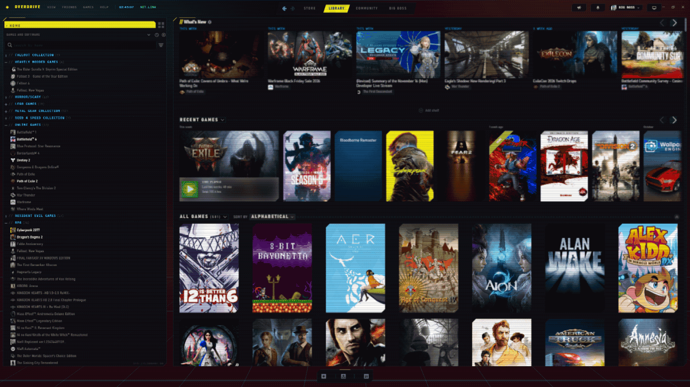
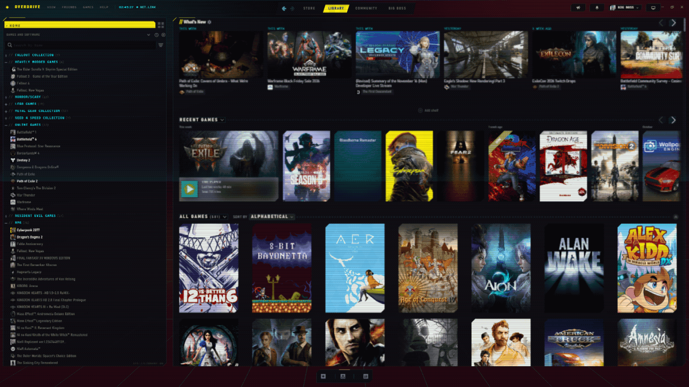
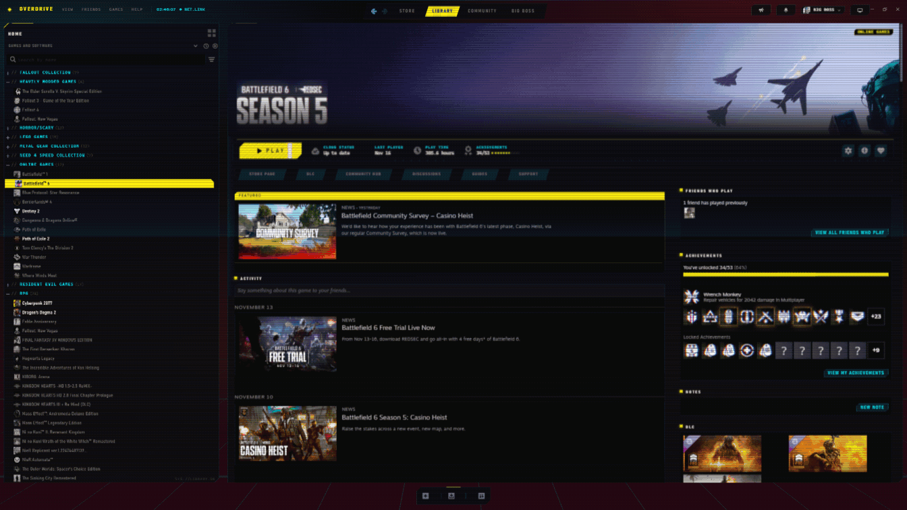

# OVERDRIVE

**A neon cyberpunk HUD for the Steam client.** A [Millennium](https://steambrew.app) theme.

Overdrive rebuilds Steam as a heads-up display. Cut-corner panels float over a living
neon city with a grid floor running toward you. Tabs are slanted slabs, the game list
reads like a data feed, and the Play button glitches when you reach for it.

## Highlights

| | |
|---|---|
| **Living city** | Flickering red, cyan and yellow neon haze over a 3D grid floor that scrolls toward you, plus CRT scanlines and a slow scan beam. |
| **HUD chrome** | Cut-corner panels with edge marks and system tags, a glitching `OVERDRIVE` logo, and a live clock and network readout in the top bar. |
| **Navigator** | Store / Library / Community as slanted tabs; a striped yellow slab slides to the active one. |
| **Data-feed library** | `// COLLECTION` headers in monospace, cyan rails on hover, and the selected game shown dark on yellow. |
| **Covers** | Cut corners, 3D tilt toward the cursor, a scan-line glare and a neon frame. |
| **Game page** | The game logo glitches in when the page opens. The Play button is a striped yellow slab that slice-glitches on hover. Progress bars are segmented neon. |
| **Boot sequence** | An `OVERDRIVE` boot screen when the Steam window opens (it can be turned off). |
| **Everywhere** | Right-click menus, notifications (`INCOMING // TRANSMISSION`), the sign-in reticle, settings, friends and chat, and the Store and Community pages. |

## Signals: five palettes plus your own

**Voltage** (yellow / cyan / red), **Redline**, **Netwave**, **Toxic** and **Chrome**.
Pick **Custom** to use your own four colors from the theme's Colors page.

## Options

Open **Millennium → Themes → Overdrive** to change any of these:

- **Look:** Signal palette · City (Live / Static / Blackout) · Grid floor · Scanlines (Normal / Heavy CRT / Off) · Corner cut · Panel opacity · Panel blur
- **Layout:** Floating or Seamless panels · Navigator position · Game list density · What's New shelf · Dock labels · HUD clock
- **Motion:** Glitch (Full / Subtle / Off) · Boot sequence · Motion (Full / Calm / Still) · Cover hover (Tilt / Lift / Off) · Cursor light
- **Extras:** Privacy blur on your account name and wallet

Overdrive honors Windows' *reduce motion* setting, and **Motion → Still** turns off every
animation the theme adds.

## Install

1. Install [Millennium](https://steambrew.app).
2. Install Overdrive from the [theme gallery](https://steambrew.app/themes), or clone this repo into
   `Steam/millennium/themes/Overdrive`.
3. In Steam, open **Millennium → Themes** and select **Overdrive**.

## Notes

- Fonts: Bahnschrift and Cascadia Mono. Both ship with Windows, so the theme loads nothing remote.
- Overdrive is an original cyberpunk-genre design. It is not affiliated with Valve or with any game,
  and it uses no game's name, logo, fonts or artwork.
- Steam updates sometimes rename the client's internal classes. If something looks off after a
  Steam update, please open an issue.

## License

[MIT](LICENSE)
